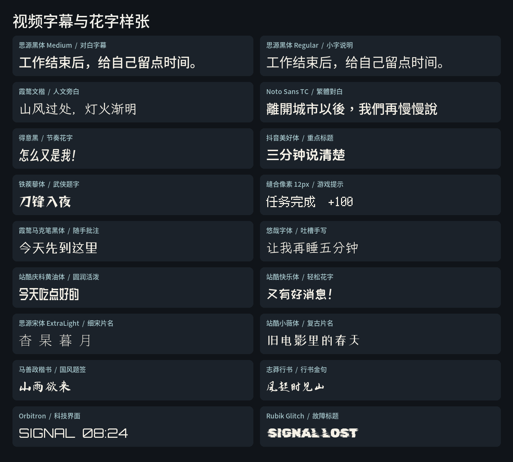

# 视频字幕与花字字体库

收录适合对白、片名和花字的原版 TTF / OTF。中文对白可从**思源黑体 Medium**开始选，小字号说明可用 Regular。国风、游戏、吐槽和科技片头可以在样张中对比。



新项目可直接克隆，已有本地副本可拉取更新。

```sh
git clone https://github.com/lisuisui22/source-han-video-fonts.git
```

剪辑软件可安装所需的字体文件后按字体名选用。代码视频可从 `assets/fonts/` 按文件路径加载，确认字重后再渲染。可变字体的字重按剪辑软件支持情况选用。做科普字幕时，思源黑体的这三个字重均缺少下标字符 ₂，若要直接显示 O₂，可以使用霞鹜文楷或单独为下标指定备用字体。

GB2312 覆盖列统计 6,763 个简体常用汉字，不包含标点、拉丁字母和扩展汉字。用花字前可以先试渲染实际台词，繁体或生僻字尤其值得检查。

## 中文字幕

| 字体 | 用途 | GB2312 汉字覆盖 | 来源及许可证 |
| --- | --- | ---: | --- |
| [思源黑体 Regular](assets/fonts/SourceHanSansSC-Regular.otf) | 常规对白、说明小字 | 6,763/6,763 | [上游](https://github.com/adobe-fonts/source-han-sans/tree/6c709ca72d3d7c46ab42ebecc1a26e7d69595a37) · [OFL](assets/fonts/OFL-SourceHanSans.txt) |
| [思源黑体 Medium](assets/fonts/SourceHanSansSC-Medium.otf) | 竖屏对白、复杂画面上的字幕 | 6,763/6,763 | [上游](https://github.com/adobe-fonts/source-han-sans/tree/6c709ca72d3d7c46ab42ebecc1a26e7d69595a37) · [OFL](assets/fonts/OFL-SourceHanSans.txt) |
| [霞鹜文楷](assets/fonts/lxgw-wenkai/LXGWWenKai-Regular.ttf) | 人文旁白、书摘、纪录片字幕 | 6,763/6,763 | [上游](https://github.com/lxgw/LxgwWenKai/releases/tag/v1.530) · [OFL](assets/fonts/lxgw-wenkai/OFL.txt) |
| [Noto Sans TC](assets/fonts/notosanstc/NotoSansTC%5Bwght%5D.ttf) | 繁体对白，可变字重 | 4,865/6,763 | [上游](https://github.com/google/fonts/tree/6ebe737e44fd64ee736bbc6feed6136a6dbfd222/ofl/notosanstc) · [OFL](assets/fonts/notosanstc/OFL.txt) |
| [jf open 粉圆](assets/fonts/huninn/Huninn-Regular.ttf) | 圆体，轻松科普和生活类短句 | 4,627/6,763 | [上游](https://github.com/google/fonts/tree/6ebe737e44fd64ee736bbc6feed6136a6dbfd222/ofl/huninn) · [OFL](assets/fonts/huninn/OFL.txt) |

## 片名和花字

| 字体 | 用途 | GB2312 汉字覆盖 | 来源及许可证 |
| --- | --- | ---: | --- |
| [思源黑体 Heavy](assets/fonts/SourceHanSansSC-Heavy.otf) | 主标题、强强调 | 6,763/6,763 | [上游](https://github.com/adobe-fonts/source-han-sans/tree/6c709ca72d3d7c46ab42ebecc1a26e7d69595a37) · [OFL](assets/fonts/OFL-SourceHanSans.txt) |
| [思源宋体 ExtraLight](assets/fonts/SourceHanSerifSC-ExtraLight.otf) | 细字片名、天象字、留白标题 | 6,763/6,763 | [上游](https://github.com/adobe-fonts/source-han-serif/tree/7889f11bf31170b5d092a083b357c8c8130f89e0) · [OFL](assets/fonts/OFL-SourceHanSerif.txt) |
| [霞鹜马克笔黑体](assets/fonts/lxgwmarkergothic/LXGWMarkerGothic-Regular.ttf) | 马克笔笔触，弹幕、强调词 | 6,763/6,763 | [上游](https://github.com/google/fonts/tree/6ebe737e44fd64ee736bbc6feed6136a6dbfd222/ofl/lxgwmarkergothic) · [OFL](assets/fonts/lxgwmarkergothic/OFL.txt) |
| [站酷庆科黄油体](assets/fonts/zcoolqingkehuangyou/ZCOOLQingKeHuangYou-Regular.ttf) | 圆润饱满，食品、好物标题 | 6,763/6,763 | [上游](https://github.com/google/fonts/tree/6ebe737e44fd64ee736bbc6feed6136a6dbfd222/ofl/zcoolqingkehuangyou) · [OFL](assets/fonts/zcoolqingkehuangyou/OFL.txt) |
| [站酷快乐体](assets/fonts/zcoolkuaile/ZCOOLKuaiLe-Regular.ttf) | 俏皮手写，轻松段落和花字 | 6,763/6,763 | [上游](https://github.com/google/fonts/tree/6ebe737e44fd64ee736bbc6feed6136a6dbfd222/ofl/zcoolkuaile) · [OFL](assets/fonts/zcoolkuaile/OFL.txt) |
| [站酷小薇体](assets/fonts/zcoolxiaowei/ZCOOLXiaoWei-Regular.ttf) | 复古印刷感，片名、封面 | 6,763/6,763 | [上游](https://github.com/google/fonts/tree/6ebe737e44fd64ee736bbc6feed6136a6dbfd222/ofl/zcoolxiaowei) · [OFL](assets/fonts/zcoolxiaowei/OFL.txt) |
| [马善政楷书](assets/fonts/mashanzheng/MaShanZheng-Regular.ttf) | 毛笔楷书，国风、节气题字 | 6,763/6,763 | [上游](https://github.com/google/fonts/tree/6ebe737e44fd64ee736bbc6feed6136a6dbfd222/ofl/mashanzheng) · [OFL](assets/fonts/mashanzheng/OFL.txt) |
| [龙藏体](assets/fonts/longcang/LongCang-Regular.ttf) | 毛笔行笔，国风和文化片名 | 6,763/6,763 | [上游](https://github.com/google/fonts/tree/6ebe737e44fd64ee736bbc6feed6136a6dbfd222/ofl/longcang) · [OFL](assets/fonts/longcang/OFL.txt) |
| [刘建毛草](assets/fonts/liujianmaocao/LiuJianMaoCao-Regular.ttf) | 笔画舒展，草书情绪题字 | 6,763/6,763 | [上游](https://github.com/google/fonts/tree/6ebe737e44fd64ee736bbc6feed6136a6dbfd222/ofl/liujianmaocao) · [OFL](assets/fonts/liujianmaocao/OFL.txt) |
| [志莽行书](assets/fonts/zhimangxing/ZhiMangXing-Regular.ttf) | 动态行书，短句、情绪金句 | 6,763/6,763 | [上游](https://github.com/google/fonts/tree/6ebe737e44fd64ee736bbc6feed6136a6dbfd222/ofl/zhimangxing) · [OFL](assets/fonts/zhimangxing/OFL.txt) |
| [抖音美好体](assets/fonts/douyin-sans/DouyinSansBold.ttf) | 短视频重点字幕、粗标题 | 6,763/6,763 | [上游](https://github.com/bytedance/fonts/tree/327565b61501d7a6d4902ed6ce417a7bd2ae54e6/DouyinSans) · [OFL](assets/fonts/douyin-sans/OFL.txt) |
| [得意黑](assets/fonts/smiley-sans/SmileySans-Oblique.ttf) | 倾斜动感，科技、数码、反转 | 6,763/6,763 | [上游](https://github.com/atelier-anchor/smiley-sans/releases/tag/v2.0.1) · [OFL](assets/fonts/smiley-sans/OFL.txt) |
| [铁蒺藜体](assets/fonts/tiejili/TiejiliSC-Regular.otf) | 棱角尖锐，武侠、国潮、热血 | 6,763/6,763 | [上游](https://github.com/Buernia/Tiejili/releases/tag/1.100) · [OFL](assets/fonts/tiejili/OFL.txt) |
| [缝合像素 12px](assets/fonts/fusion-pixel/fusion-pixel-12px-proportional-zh_hans.ttf) | 简体像素字，游戏、复古、系统提示 | 6,727/6,763 | [上游](https://github.com/TakWolf/fusion-pixel-font/releases/tag/2026.11.10) · [OFL](assets/fonts/fusion-pixel/OFL.txt) |
| [悠哉字体](assets/fonts/yozai/Yozai-Regular.ttf) | 松弛手写，吐槽和日记体花字 | 6,763/6,763 | [上游](https://github.com/lxgw/yozai-font/releases/tag/v0.868) · [OFL](assets/fonts/yozai/OFL.txt) |

## 英文、数字和代码

| 字体 | 用途 | 来源及许可证 |
| --- | --- | --- |
| [Bebas Neue](assets/fonts/bebasneue/BebasNeue-Regular.ttf) | 窄体英文标题和数字 | [上游](https://github.com/google/fonts/tree/6ebe737e44fd64ee736bbc6feed6136a6dbfd222/ofl/bebasneue) · [OFL](assets/fonts/bebasneue/OFL.txt) |
| [Orbitron](assets/fonts/orbitron/Orbitron%5Bwght%5D.ttf) | 科幻界面和仪表数字，可变字重 | [上游](https://github.com/google/fonts/tree/6ebe737e44fd64ee736bbc6feed6136a6dbfd222/ofl/orbitron) · [OFL](assets/fonts/orbitron/OFL.txt) |
| [Rubik Glitch](assets/fonts/rubikglitch/RubikGlitch-Regular.ttf) | 故障风英文标题 | [上游](https://github.com/google/fonts/tree/6ebe737e44fd64ee736bbc6feed6136a6dbfd222/ofl/rubikglitch) · [OFL](assets/fonts/rubikglitch/OFL.txt) |
| [Share Tech Mono](assets/fonts/sharetechmono/ShareTechMono-Regular.ttf) | 终端、代码和时码 | [上游](https://github.com/google/fonts/tree/6ebe737e44fd64ee736bbc6feed6136a6dbfd222/ofl/sharetechmono) · [OFL](assets/fonts/sharetechmono/OFL.txt) |
| [Press Start 2P](assets/fonts/pressstart2p/PressStart2P-Regular.ttf) | 街机像素英文和数字 | [上游](https://github.com/google/fonts/tree/6ebe737e44fd64ee736bbc6feed6136a6dbfd222/ofl/pressstart2p) · [OFL](assets/fonts/pressstart2p/OFL.txt) |
| [Caveat](assets/fonts/caveat/Caveat%5Bwght%5D.ttf) | 英文手写批注，可变字重 | [上游](https://github.com/google/fonts/tree/6ebe737e44fd64ee736bbc6feed6136a6dbfd222/ofl/caveat) · [OFL](assets/fonts/caveat/OFL.txt) |

## 许可证

字体保留各自的 SIL Open Font License 1.1，允许用于包括商业项目在内的视频成片。随项目再分发字体文件时，请一并保留上游版权声明与许可证。缝合像素字体还附有[上游随包提供的衍生字体许可证](assets/fonts/fusion-pixel/LICENSES/)。
